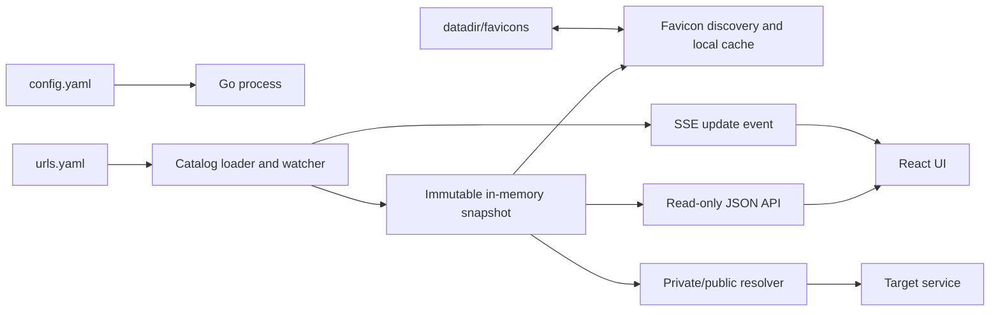

# Navi 设计文档

状态：已批准的实现基线  
版本：1.4.0
日期：2026-08-03

## 1. 文档约束

本项目后续实现必须以本文件、`docs/UI_SPEC.md`、`docs/CODING_STANDARDS.md`、
`docs/IMPLEMENTATION.md` 和 `docs/ACCEPTANCE.md` 为执行依据。任何需求、架构、
接口、配置格式、UI 组件规范、编码规范或验收标准的变化，必须在修改代码的同一次工作中
更新 `docs/CHANGELOG.md`，并同步修改受影响文档。

优先级从高到低如下：

1. 用户最新确认的需求。
2. `docs/CHANGELOG.md` 中已接受的变更。
3. `docs/DESIGN.md` 的产品与架构定义。
4. `docs/UI_SPEC.md` 的组件、响应式和视觉一致性契约。
5. `docs/CODING_STANDARDS.md` 的生产级工程约束。
6. `docs/ACCEPTANCE.md` 的可验证行为。
7. `docs/IMPLEMENTATION.md` 的实施顺序。

## 2. 产品定义

Navi 是一个以 UI/UX 为唯一核心目标的只读个人导航系统。Go 服务读取 `urls.yaml`，
将其中的页面、分组和链接按文件内顺序渲染为高质感、响应式的 Web 导航界面。产品不以功能数量
衡量成功，而以视觉完成度、交互自然度、感知速度和长期使用舒适度衡量成功。

系统不提供登录、用户、数据库、拖拽排序、Web 编辑或 Web 回写 YAML。
`urls.yaml` 是导航页面、内容、分组和顺序的唯一事实来源。浏览器和服务内存中的数据只允许作为
运行时缓存，不得成为第二份持久化事实。

### 2.1 核心目标

- 高品质、克制的黑白 UI，信息密度适中，适合每天高频使用。
- UI/UX 质量拥有发布否决权；功能正确但视觉粗糙、动效僵硬或操作费力时不得发布。
- 严格按照 `urls.yaml` 展示页面、分组、链接和顺序。
- YAML 修改后自动热加载，页面无需手动刷新即可更新。
- 自动发现目标站点 favicon，下载到 `datadir` 并由本站稳定提供。
- 点击链接时优先使用 `private_url`；不可达时自动切换 `public_url`。
- 提供快速搜索、键盘操作、响应式布局和清晰的异常状态。
- 支持手机、平板、桌面、超宽屏、横竖屏、缩放、高 DPI、触控和键鼠等显示场景。
- 后端使用 Go，前端随二进制嵌入并由同一进程提供。
- 支持 `-f` 和 `configpath` 环境变量指定主配置文件。

### 2.2 非目标

- 不实现登录、权限、用户偏好同步或多租户。
- 不使用数据库，也不持久化导航目录、顺序或用户状态；`datadir` 只保存可重建的
  favicon 派生缓存。
- 不实现拖拽排序、链接编辑、分组编辑或任何写入 API。
- 不代理目标网站内容，不做通用反向代理。
- 不保证服务端网络视角与每一台访问设备完全一致。
- 第一版不做插件系统、在线图标市场、访问统计和推荐算法。
- 不为展示技术能力而增加动画、3D、粒子、视差、磁吸光标或其他干扰导航效率的效果。

## 3. 关键设计原则

### 3.1 YAML 单一事实源

- 导航内容只来自当前主配置指向的 `urls.yaml`。
- 页面顺序就是 YAML 中 `pages` 数组的顺序。
- 每页链接顺序就是该页 `urls` 数组的顺序。
- 分组顺序由该分组第一次出现在当前页 `urls` 数组中的位置决定。
- 同一分组内的链接保持它们在 `urls` 数组中的相对顺序。
- 服务不得生成、修改或重写 `urls.yaml`。
- 热加载失败时可短暂保留内存中的最后有效快照，但必须标记为降级状态；
  该快照不落盘，也不是新的事实来源。

### 3.2 UI 优先

- 首屏直接展示导航，不使用营销式落地页。
- 所有技术和功能选择必须服务于视觉层级、操作效率、感知速度或日常使用愉悦度。
- 质量优先级依次为：信息架构、排版与间距、交互反馈、动效连续性、细节文案、功能数量。
- 分组是无外层卡片的页面区段；链接本身可以使用紧凑卡片。
- 动效用于建立空间关系、表达因果、反馈状态和掩盖必要等待，不作为独立装饰。
- 黑白和中性灰是主色；绿色、黄色、红色只用于可用性状态。
- 内容永远优先于装饰，不使用渐变球、玻璃拟态、大面积插画或过度阴影。

### 3.3 可预期运行

- 配置非法时启动失败并给出准确字段路径。
- 运行中热加载到非法 YAML 时继续提供最后有效页面，同时健康检查返回降级。
- 所有探测都有严格超时、缓存和并发上限。
- 所有公开行为必须能通过自动化测试或明确的人工验收步骤复现。
- 所有代码必须满足 `docs/CODING_STANDARDS.md`，弃用 API、字段和依赖默认按构建错误处理。

## 4. 总体架构



### 4.1 进程组成

- 配置加载器：解析主配置、处理路径优先级、校验持续时间和枚举值。
- 目录加载器：使用 YAML AST 和强类型模型解析 `urls.yaml`。
- 文件观察器：监听父目录中的文件替换、创建和写入事件，防抖后重新加载。
- 快照仓库：通过不可变快照和原子指针向请求提供一致视图。
- Favicon 管理器：发现站点图标、受限下载、校验并缓存到 `datadir/favicons`。
- 链接解析器：探测内网、回退外网、缓存结果并返回 HTTP 重定向。
- HTTP API：提供目录数据、状态、SSE 事件、健康检查和静态资源。
- Web UI：React + TypeScript 应用，构建产物通过 `go:embed` 进入二进制。

### 4.2 技术选择

| 领域 | 选择 | 原因 |
| --- | --- | --- |
| 后端 | Go 标准库 `net/http` | 依赖少，单二进制，足够覆盖路由与中间件 |
| YAML | `gopkg.in/yaml.v3` | 支持严格解析和清晰错误定位 |
| HTML 解析 | `golang.org/x/net/html` | 安全解析标准的 `link rel="icon"` 声明 |
| 文件监听 | `fsnotify` | 处理编辑器原子替换和跨平台文件事件 |
| 前端 | React + TypeScript + Vite | 适合精细交互、组件化和可靠构建 |
| 状态请求 | TanStack Query | 管理目录请求、重试和缓存失效 |
| 动效 | Motion for React + CSS transitions | 提供布局连续性、弹簧与可控退出动画 |
| 图标 | Lucide React | 统一、克制、可访问的图标体系 |
| 测试 | Go test + Vitest + Playwright | 覆盖单元、集成、行为和视觉回归 |

不得引入数据库、ORM、服务端模板系统或重量级 Go Web 框架。

## 5. 配置设计

### 5.1 主配置路径优先级

进程按以下顺序选择主配置：

1. 命令行 `-f /absolute/or/relative/config.yaml`。
2. 环境变量 `configpath`。
3. 当前工作目录下的 `./config.yaml`。

当 `-f` 与 `configpath` 同时存在时，`-f` 必须优先。空字符串视为未设置。
主配置中的相对路径以主配置文件所在目录为基准，不以进程工作目录为基准。
`datadir` 遵循同一规则。

### 5.2 主配置格式

```yaml
datadir: ./data

# Themes: default（默认）、navy-blossom（绀樱夜）、mint-tide（薄荷汐）、
# moss-court（苔庭青）、tea-mist（茶雾青）、amber-tide（琥珀潮）、
# sunny-coast（晴海橙）、violet-lime（藤萝青）。
theme: default

# Background patterns: none（素幕）、meridian-grid（经纬阵）、orbital-rings（天游环）、
# pisces（双鱼宫）、sagittarius（天弓宫）、roman-meander（回廊纹）、
# rose-window（玫瑰窗）、eight-point-star（八芒阵）、star-trails（星轨幕）。
background_pattern: meridian-grid

# Web search: baidu、google、yandex、bing、github、chatgpt、claude、gemini。
web_search: baidu

server:
  # Use 0.0.0.0 in a container or when a reverse proxy connects remotely.
  listen: 127.0.0.1
  port: 8080
  read_header_timeout: 5s
  read_timeout: 20s
  write_timeout: 30s
  idle_timeout: 90s
  shutdown_timeout: 10s

health:
  uri: /health

logging:
  # Supported levels: debug, info, warn, error.
  level: info
  # Supported formats: json, logfmt.
  format: json
  access_log: true
  log_health_checks: false

catalog:
  path: ./urls.yaml
  watch: true
  reload_debounce: 250ms

navigation:
  private_probe_timeout: 800ms
  public_probe_timeout: 1200ms
  probe_cache_ttl: 30s
  max_concurrent_probes: 32

favicon:
  fetch_timeout: 3s
  refresh_interval: 168h
  max_file_bytes: 1048576
  workers: 4
```

配置解析要求：

- 未知字段导致启动失败，避免拼写错误被静默忽略。
- `server.port` 范围为 1-65535。
- 所有 timeout 必须大于 0。
- `health.uri` 必须以 `/` 开头，且不能覆盖保留路由。
- `catalog.path` 必须存在、是普通文件且可读。
- `datadir` 必须是目录或可被程序创建；其相对路径以主配置目录为基准。
- `theme` 默认值为 `default`，只接受配置注释列出的 8 个稳定标识；未知值导致启动失败。
- `background_pattern` 默认值为 `meridian-grid`，只接受配置注释列出的 9 个稳定标识；
  未知值导致启动失败。
- `web_search` 默认值为 `baidu`，只接受配置注释列出的 8 个入口标识；未知值导致启动失败。
- `favicon.max_file_bytes` 范围为 1024 到 4194304，`workers` 范围为 1-16。
- `logging.level` 和 `logging.format` 只接受注释中列出的值。

### 5.3 导航配置格式

```yaml
version: 1

pages:
  - id: page1
    title: 我的导航
    subtitle: 工作、服务与常用资源
    urls:
      - name: Grafana
        group: 基础设施
        description: Metrics and dashboards
        private_url: http://grafana.lan:3000
        public_url: https://grafana.example.com
        tags: [monitoring, metrics]

  - id: page2
    title: 阅读与灵感
    subtitle: 稍后继续探索的内容
    urls:
      - name: Are.na
        group: 灵感
        public_url: https://www.are.na
        tags: [research]
```

字段约束：

| 字段 | 必填 | 规则 |
| --- | --- | --- |
| `version` | 是 | 第一版只接受整数 `1` |
| `pages` | 是 | 有序数组，1-20 页；旧版顶层 `site/urls` 不接受 |
| `pages[].id` | 是 | 唯一；小写字母开头，只含小写字母、数字和连字符，最长 32 字符 |
| `pages[].title` | 是 | 去除首尾空格后 1-40 个 Unicode 字符 |
| `pages[].subtitle` | 否 | 最多 100 个 Unicode 字符 |
| `pages[].urls` | 是 | 数组，允许为空；所有页面合计最大 1000 项 |
| `name` | 是 | 1-60 个 Unicode 字符 |
| `group` | 是 | 1-40 个 Unicode 字符 |
| `description` | 否 | 最多 120 个 Unicode 字符 |
| `private_url` | 条件必填 | 与 `public_url` 至少存在一个 |
| `public_url` | 条件必填 | 与 `private_url` 至少存在一个 |
| `tags` | 否 | 最多 10 项，每项 1-24 个字符，用于搜索 |

URL 仅允许 `http` 和 `https`。同一页面中完全相同的
`group + name + private_url + public_url` 组合视为重复并拒绝加载；不同页面可以复用同一目标。
运行时链接 ID 包含页面 ID，因此跨页复用不会共享导航或 favicon 键。
图标不在 `urls.yaml` 中配置，由 favicon 管理器自动发现。加载失败时，UI 使用链接名称
首字符的中性字标，不依赖第三方图标服务。

多页 UI 使用固定在视口底部中央的 Morphing Page Dots。独立分页层高于目录正文、低于 sticky
顶栏、顶栏菜单、全屏搜索和对话层，空白区域不捕获指针；正文为 44px 触控目标、底部偏移和
safe area 预留空间，因此长页
无需滚到底即可切换，最后一排链接也不会被遮挡。非活动页为小圆点，当前页为短横胶囊，共享
indicator 在页点之间线性形变移动并触发一次轻微外扩反馈；页面内容仍按前进/后退方向水平过渡。
reduced motion 下取消 indicator 移动、外扩反馈和内容水平位移。

## 6. 目录加载与热更新

### 6.1 启动加载

1. 解析主配置并解析 `catalog.path`。
2. 读取完整 YAML，限制文件大小为 2 MiB。
3. 执行语法、字段、URL 和重复项校验。
4. 构建不可变目录快照、分组视图和运行时链接 ID。
5. 若任一步失败，记录结构化错误并以非零状态退出。

运行时 ID 由规范化后的链接关键字段计算 SHA-256，并取足够长度的 URL-safe
编码。ID 只用于当前目录快照中的 API 和跳转路由，不写回 YAML。

### 6.2 热加载

- 观察 `urls.yaml` 的父目录，以兼容编辑器通过 rename 原子保存文件。
- 文件事件经过 `reload_debounce` 防抖。
- 新文件完全校验通过后，才一次性替换内存快照。
- 成功后递增 revision，并通过 SSE 发送 `catalog.updated`。
- 前端收到事件后重新请求目录，保留滚动位置和当前搜索词。
- 加载失败时保留最后有效快照，记录错误，发送 `catalog.error`，健康状态变为
  `degraded`。
- 后续合法文件加载成功后，健康状态自动恢复为 `ok`。

### 6.3 Favicon 自动发现与本地缓存

Favicon 是可删除、可重建的派生缓存，不改变 `urls.yaml` 的唯一事实源地位。

目录规则：

- 根目录来自主配置 `datadir`。
- 图标文件保存到 `datadir/favicons/`。
- 缓存文件名使用目标规范化 origin 和运行时链接 ID 的 SHA-256 摘要，禁止使用远端文件名，
  防止路径穿越和重名。
- 元数据 sidecar 记录来源 URL、内容类型、ETag、Last-Modified、抓取时间和内容哈希。
- 目录权限目标为 `0750`，新缓存文件权限目标为 `0640`，并遵守进程 umask。

发现顺序：

1. 优先使用 `public_url` 作为发现入口；没有或失败时使用 `private_url`。
2. 对入口页面执行受限 `GET`，最多读取 HTML 前 256 KiB。
3. 解析 `<link rel="icon">`、`shortcut icon` 和 `apple-touch-icon`，
   解析相对 URL，并优先选择声明尺寸最接近 64x64 的候选。
4. 声明图标均失败时尝试该 origin 的 `/favicon.ico`。
5. public 入口未取得图标时，再对 private 入口重复该流程。

下载规则：

- 只允许 `http` 和 `https`，总超时为 `favicon.fetch_timeout`，最多跟随 3 次重定向。
- 响应体不得超过 `max_file_bytes`；先写同目录临时文件，校验成功后原子 rename。
- 依据响应头与内容探测双重校验，只接受 ICO、PNG、JPEG、WebP、GIF 和 SVG 图像。
- SVG 必须是可解析的 SVG 文档；通过独立图像响应路由提供，并附加严格 CSP 和
  `nosniff`，不得作为 HTML 或脚本执行。
- 使用 ETag/Last-Modified 条件请求；缓存未超过 `refresh_interval` 时不重新抓取。
- 后台 worker 数量由 `favicon.workers` 限制，不阻塞目录首屏和链接跳转。
- 同一来源的并发抓取使用 singleflight 合并。
- 目录更新后不再引用的缓存进入清理候选，至少保留 24 小时后才删除。

前端始终先渲染稳定字标。缓存命中时直接展示本站图标路由；新图标后台下载完成后，
服务通过 SSE 发送 `favicon.updated`，前端无布局位移地替换字标。抓取失败只记录
限频日志并按刷新周期重试，不使目录加载失败。若 `datadir` 不可写，服务继续提供导航，
health 标记为 `degraded`，所有链接使用字标。

## 7. 内外网链接选择

### 7.1 点击流程

1. UI 卡片链接始终指向本站 `/go/{runtime_id}`，默认在新标签页打开。
2. 解析器读取当前不可变快照，防止热加载造成半更新。
3. 存在 `private_url` 时，先查探测缓存；无缓存则执行快速探测。
4. 内网地址可达时立即返回 `302` 到 `private_url`。
5. 内网不可达且存在 `public_url` 时探测外网地址；可达则返回 `302`。
6. 两者均不可达时返回同风格的轻量失败页，提供“重试内网”和“重试外网”命令。

### 7.2 可达判定

- 首先发送 `HEAD`，不下载响应体，不携带用户 Cookie。
- 收到 `405` 或 `501` 时，改用带 `Range: bytes=0-0` 的 `GET`。
- HTTP 100-499 视为网络与服务可达；500-599、超时、DNS、TLS 和连接错误视为不可达。
- 重定向最多跟随 3 次；每次重定向仍受总超时约束。
- 探测结果按目标 URL 缓存 `probe_cache_ttl`，并使用 singleflight 合并并发探测。
- 并发探测总数不得超过 `max_concurrent_probes`。

### 7.3 边界说明

探测发生在 Navi 服务端。若 Navi 与访问浏览器不处于相同网络，服务端看到的内网可达性
可能不同于浏览器。第一版以“将 Navi 部署在使用者所在内网或具备相同路由的主机”为部署
前提。浏览器端通过 fetch/iframe 探测会受到 CORS、混合内容和页面跳转生命周期限制，
因此不作为第一版实现。

## 8. UI/UX 设计

### 8.1 体验标杆与借鉴原则

Navi 不复制任何品牌的页面，但以成熟设计系统的以下原则作为质量标杆：

- [Apple Human Interface Guidelines - Motion](https://developer.apple.com/design/human-interface-guidelines/motion)：
  动效必须帮助理解状态、反馈和空间关系，并允许用户减少非必要运动。
- [Material Design 3 - Motion](https://m3.material.io/styles/motion/overview/how-it-works)：
  进入、退出和容器变化保持一致方向与节奏，让界面变化看起来来自用户刚才的操作。
- [Microsoft Fluent 2 - Motion](https://fluent2.microsoft.design/motion)：
  动效保持功能性、自然与一致，并用设计令牌让运动节奏可系统性维护。
- [Material Design 3 - Color System](https://m3.material.io/styles/color/system/overview)：
  先用中性色表面建立清晰层级，再让强调色承担选中、焦点和重点交互。
- [Microsoft Fluent 2 - Color](https://fluent2.microsoft.design/color)：
  中性颜色构成高频工作界面的主体，品牌或主题色只提高关键元素的辨识度。
- [Atlassian Design System - Color](https://atlassian.design/foundations/color/)：
  组件消费语义颜色角色，不把原始色值直接散落到局部样式中。
- [Linear - A calmer interface](https://linear.app/now/behind-the-latest-design-refresh)：
  辅助界面主动退后，让用户当前关注的内容获得更清晰的视觉优先级。

借鉴只发生在原则和质量层面。不得复制品牌标识、专有图形、页面结构或辨识度过高的
动效。Navi 的自身特征是：紧凑、安静、精确，以默认黑白和可选撞色主题表达个性，并在
操作发生时自然回应。

### 8.2 视觉语言

- `default`（默认）保留现有中性黑白语言并跟随系统深浅模式：深色背景 `#0A0A0A`、
  浅色背景 `#FFFFFF`。用户从主题菜单进行的选择只保存在浏览器 `localStorage`，
  该偏好不是导航事实，且优先于主配置的默认主题。
- 主配置 `theme` 决定没有本地偏好时的初始主题，并通过 `/api/catalog` 的根级 `theme`
  提供给前端；它是运行外观配置，不属于 `urls.yaml` 导航内容。
- 彩色主题使用以下稳定标识、展示名称与核心色；核心色不再直接铺满页面画布或复制到每条
  卡片边框，而是映射到 group accent、icon background/foreground、selected、focus、hover
  等低面积语义角色。组件只能消费 background、surface、surface-soft、border、text、focus、
  accent、icon、selection、shadow 等语义 token，不得直接引用主题色值。

| 配置值 | 名称 | 核心色 |
| --- | --- | --- |
| `navy-blossom` | 绀樱夜 | `#063C85`、`#F7C3D9`、`#BB5799` |
| `mint-tide` | 薄荷汐 | `#A1FEEF`、`#658AE4`、`#28314E` |
| `moss-court` | 苔庭青 | `#D3F2DE`、`#99C39E`、`#506850` |
| `tea-mist` | 茶雾青 | `#FAF3E9`、`#A8703F`、`#5C614D` |
| `amber-tide` | 琥珀潮 | 蜜金、珊瑚与深青 |
| `sunny-coast` | 晴海橙 | 晴空蓝、电光蓝与跃动橙 |
| `violet-lime` | 藤萝青 | 藤紫、雾白与新芽绿 |

- 每个彩色主题使用克制的“中性画布 + 主题刻度”比例：中性背景、表面、文字和边框占主要
  视觉面积，主题核心色只用于分组标记、图标底、当前项、焦点和 hover 反馈。禁止使用高饱和
  核心色作为整页背景，禁止每张卡片默认使用彩色轮廓，禁止让色彩层级压过信息层级。
- 每个彩色主题必须分别校准背景、表面、边框、主次文字、焦点、图标、分组刻度、阴影和
  语义状态色，不能只替换一个 accent；所有正文、控件和焦点状态继续满足 WCAG 2.2 AA。
- 卡片圆角最大 8px，默认边框为中性色 1px；主题色只显示为短边缘刻度与图标色，阴影只在
  悬浮和键盘聚焦时出现。
- 字体优先使用系统 UI 字体；数字和状态使用等宽数字特性。
- 字间距固定为 0，不按视口宽度缩放字体。
- 状态色仅使用低饱和绿色、黄色和红色，并同时提供形状或文字提示。

#### 浮层表面与背景隔离标准

- `menu`、`listbox`、`popover` 等浮动选择面板统一属于 floating surface。它们必须消费同一组
  语义 token：不透明 `floating-surface`、中性 `floating-surface-border` 与 `shadow-menu`；
  任意主题、浏览器和 viewport 下，面板最终合成背景的 alpha 必须为 `1`。
- floating surface 的职责是隔离当前选择任务。页面正文、导航卡片和背景纹样不得透过面板形成
  可辨识文字、线条或运动；`z-index` 只解决绘制顺序，不能替代不透明背景，也不得通过提高
  blur、阴影或饱和度掩盖透明度问题。
- 不透明 floating surface 不使用 `backdrop-filter`。对不透明像素执行背景模糊没有视觉收益，
  只会增加合成成本并让同级组件形成错误的材质暗示。主题菜单、背景纹样菜单和 provider 菜单
  必须遵守同一规则，组件不得声明局部 `color-mix(..., transparent)` 或 blur 分支。
- 搜索椭圆和顶栏属于常驻 control/chrome material，不属于 floating surface；它们可以使用受控
  透明度和 blur，但必须保留实色 fallback、清晰边界和 AA 对比。全屏搜索 dialog 使用专用
  `overlay` 遮蔽面，背后内容不得达到可辨识程度，也不能产生第二条滚动轴。
- 菜单内的色样和纹样缩略图可以在自身边界内使用透明层级，因为它们只与已经不透明的父面板
  合成；透明效果不得越过缩略图边界或重新暴露页面背景。

### 8.3 页面结构

顶部栏高度固定 56px，包含：

- 左侧：站点标题和可选副标题。
- 中部：桌面端常驻搜索框，移动端显示搜索图标。
- 右侧：刷新状态、主题菜单、背景纹样菜单，纹样入口紧随主题入口。主题入口使用调色板图标，
  纹样入口使用几何轨道图标；两个菜单均有 tooltip、可访问名称，并支持指针、方向键、
  Home/End、Enter、Escape 和外部点击关闭。

页面背景使用独立的“背景纹样”层：

- 主题只定义色彩，背景纹样只定义几何秩序；两者可以任意组合，纹样线条从当前主题的
  `accent`、`accent-secondary`、`border-strong` 派生，不保存独立色板。
- 顶栏下方到页面末尾使用同一连续画布；UniversalSearch 与目录主内容不再各自铺设不同的
  实色背景。纹样位于搜索区、分组和卡片背后，卡片、菜单和输入框仍保留可读的表面层。
- 配置值固定为：`none`（素幕）、`meridian-grid`（经纬阵）、
  `orbital-rings`（天游环）、`pisces`（双鱼宫）、`sagittarius`（天弓宫）、
  `roman-meander`（回廊纹）、`rose-window`（玫瑰窗）、
  `eight-point-star`（八芒阵）、`star-trails`（星轨幕）。默认 `meridian-grid`。
- 经纬阵使用主次网格、透视对角线和中央经纬轴；天游环使用同心圆、椭圆轨道和星点；
  双鱼宫使用双鱼几何轮廓、星座节点和连接弧；天弓宫使用弓、箭与射手星座节点；回廊纹
  使用古典连续回纹；玫瑰窗使用放射花瓣、同心环与穹顶秩序；八芒阵使用八芒星与菱形镶嵌；
  星轨幕以屏幕左下方稍偏出视口的圆心绘制多层长曝光弧线，主要覆盖左侧约 60% 与下方约 60%，
  右上区域保持低密度留白。
- 纹样使用固定背景层并随页面滚动保持稳定，不捕获指针、不参与文档流、不产生布局位移，
  八套实际线条纹样默认运行确定性的语义环境动效，不增加静止配置或用户可选的静态模式：
  经纬阵缓慢校准经纬轴与中心测量点；天游环让轨道面和星体按不同周期运行；双鱼宫让两尾鱼
  沿相反弧线游动并轻摆尾部；天弓宫让箭迹周期性蓄势、掠过并归位；回廊纹沿自身单元连续
  流动；玫瑰窗内外层以不同方向缓慢转动；八芒阵沿重复晶格进行无缝相位迁移；星轨幕通过
  多层弧线的描边相位与极轻微绕心旋转形成自然长曝光流动。
- 环境动效只动画 SVG 分组的 `transform`、局部 `opacity` 或 `stroke-dashoffset`，轨迹、周期和
  相位均为固定值，不使用随机数、Canvas、粒子、JS timer 或逐帧业务脚本。纹样切换继续使用
  标准 opacity 过渡；`prefers-reduced-motion: reduce` 下停止环境动效并立即完成切换。
- 本地选择写入 `localStorage` 并覆盖 `config.yaml` 默认值；没有本地选择时配置热更新立即生效。
  “素幕”是正式选项，用于完全关闭背景线条，但不改变主题、卡片或搜索材质。
- 线宽在 1-1.25 CSS px，背景有效对比保持克制；纹样不得穿透文字和焦点，不得让卡片边界、
  搜索输入或状态提示失去层级，也不得在移动端形成横向溢出或高频摩尔纹。
- 星轨幕允许使用独立的加强层级：引导圆约 1.1px，三档长曝光轨迹约 1.3-1.55px，整体图层
  opacity 约 0.86；粗细必须保持明确层级，不能把所有圆弧统一加粗，也不能超过正文、焦点和
  卡片边界的视觉优先级。

顶部栏下方是开放式外部搜索工作台：

- desktop/tablet 高度使用 `clamp(330px, 40vh, 460px)`，phone 由内容和稳定 padding 决定；
  搜索区不放进大卡片，不增加营销标题、说明段落、装饰渐变或图片背景。
- 搜索工作区最大宽度 960px；主搜索器是短椭圆，desktop 静止宽约 640px。鼠标指针进入搜索器
  后启动一次 8000ms 展开窗口，指针离开不立即收回，再次进入会重新计时；窗口结束后自动收回。
  `focus-within` 或入口菜单打开时无条件保持展开。展开通过 FLIP/layout animation 到约 820px，
  使用 220ms `cubic-bezier(0, 0, 0.38, 0.9)`；收回使用 180ms
  `cubic-bezier(0.2, 0, 0.38, 0.9)`。不使用 spring、回弹或恒速 linear。高度始终 72px、圆角
  始终 999px。phone 高 60px 并始终占满可用宽度，不执行宽度展开或指针计时。
- 当前目标、查询输入和搜索命令在一个连续表面中完成，点击搜索或在输入框按 Enter 均在新
  标签页打开结果。宽度变化只使用 compositor 友好的 layout animation，禁止直接插值 width。
- 网页入口固定为百度、Google、Yandex、Bing 国际版和 GitHub；默认值来自主配置
  `web_search`，缺失时选择百度。Bing 必须
  使用 `https://www.bing.com/`，不能使用中国版域名或国内特定入口。
- 模型入口固定为 ChatGPT、Claude、Gemini。ChatGPT 使用可携带查询的新对话 URL；Claude
  和 Gemini 的网页端没有项目可依赖的稳定公开查询 URL，因此提交时先打开官方新对话页，
  再尝试把问题写入剪贴板并通过稳定状态文字说明下一步。剪贴板失败时仍打开目标页面并
  明确提示手动粘贴，不能静默丢失查询。
- 主搜索器左侧只显示当前 provider 的圆形图标按钮；按钮 accessible name 使用
  `搜索入口：{完整名称}`。点击后打开单个 `menu`，内部以“网页”和“模型”分组展示 8 个
  `menuitemradio`；支持方向键、Home/End、Enter、Escape、Tab 和外部点击关闭。选择只在当前
  会话中生效，不写 localStorage；刷新后回到 `web_search` 配置值。
- 每个 provider 使用官方轮廓比例的品牌图标；百度保留官方爪印外轮廓，但去除在 21/24px 下
  不可辨且会产生不稳定抗锯齿的 `du` 微字。Google 使用四色 G，Gemini 使用红/黄/绿/蓝四向
  混合的渐变星形；四种颜色在 18/24px 下都必须可辨，二者
  不得被 `currentColor` 压成单色。其余 provider 继续使用自身单一品牌色。菜单选项 target 不小于
  44x44px，名称长短不得改变输入起点、按钮位置或菜单网格。品牌原色只允许出现在图标本体，
  不能进入页面背景、边框、阴影或选中态，避免与用户选择的撞色主题形成多套互相竞争的颜色。
  当前 provider 徽章使用固定纸白表面和固定中性边界，内部只保留一个居中的品牌 SVG，不叠加
  小箭头、角标或第二枚图标；徽章不继承主题文字色，也不对 color/background/border 做主题过渡。
- 搜索工作台使用透明的连续画布、稳定边界和有限阴影。允许以功能性材质
  表达层级：低透明表面、细边界、内侧高光、受控 `backdrop-filter` 和不支持模糊时的实色
  fallback；禁止装饰性玻璃拟态、渐变光球、bokeh、彩色雾团和依赖透明度维持可读性的文字。
- 色带可以使用极低对比度的规则网格、短刻度或印刷纹理作为结构点缀，但不得模拟图片背景，
  不得干扰输入焦点或目录内容。搜索台只保留一个主要视觉重心，provider 图标负责快速识别，
  当前主题负责交互反馈；不在搜索器周围增加角色、挂件或随机装饰动画。
- 导航第一分组必须在 1440x900 首屏下缘可见，避免搜索区成为占满首屏的营销 hero。

主内容：

- 最大内容宽度 1440px，左右安全间距在桌面为 32px、移动端为 16px。
- 分组使用 3px 主题刻度、清晰标题和链接数量，不使用横向分隔线，也不包裹在外层卡片中；相邻
  分组可在同一主题的三组校准强调色间轮换，但不得改变信息语义。
- 链接使用内容驱动的响应式 CSS Grid：
  `repeat(auto-fill, minmax(min(100%, 272px), 1fr))`。列数由实际容器宽度决定，
  空间不足时自然回到单列，不按设备品牌硬编码。
- 卡片标准最小高度 104px，名称最多两行，secondary text 固定预留两行并最多显示两行；
  缩放、无空格长词或名称换行时允许继续增高。
- 图标区尺寸稳定为 36x36px，加载失败不会导致布局位移。
- 主题菜单自身保持中性表面，三色色样负责预览原始核心色；当前项通过低面积主题底、左侧
  刻度、勾选和 `aria-checked` 共同表达，不能只靠彩色边框。
- 主题菜单、背景纹样菜单和 provider 菜单共享不透明 floating surface；三者的内容密度、宽度
  和选项结构可以不同，但背景隔离、边界、阴影与无 blur 原则不得分叉。
- 所有精确尺寸、间距、组件状态、viewport、zoom 和几何容差以
  `docs/UI_SPEC.md` 为唯一 UI 组件契约，不允许组件局部覆盖。

### 8.4 动效系统

所有动画必须使用统一 token，不允许组件自行发明时长和 easing。

```css
--motion-instant: 80ms;
--motion-fast: 140ms;
--motion-standard: 220ms;
--motion-emphasis: 360ms;
--motion-ambient-fast: 18s;
--motion-ambient-standard: 36s;
--motion-ambient-slow: 72s;
--motion-ambient-orbit: 108s;

--ease-standard: cubic-bezier(0.2, 0, 0, 1);
--ease-out: cubic-bezier(0.22, 1, 0.36, 1);
```

结构性布局变化使用低回弹 spring，建议初始参数为 stiffness 420、damping 36、mass 0.8，
最终以真实设备手感和性能测试调整。高频 hover/press 使用 CSS transition；列表进入、
退出和重排使用 Motion for React。普通操作动画不得超过 480ms，也不得阻塞点击或输入。
背景纹样的环境运动不属于操作反馈时长，必须使用共享 ambient token，且单周期不得短于 18s。

关键场景：

1. 首次进入：顶栏在 220ms 内淡入；首屏分组从下方 8px 进入，单组时长 360ms，
   stagger 28ms，总编排不超过 600ms。只在首次页面进入播放，目录热更新不得重播全场。
2. 卡片 hover：反馈在 50ms 内开始，卡片上移 2px，边框和背景轻微提亮，图标放大到
   1.04；140ms ease-out 完成。不得使用倾斜、强发光或大幅阴影。
3. 卡片 press：在 80ms 内回落并缩放到 0.985，释放后快速恢复，使点击有明确触感。
4. 搜索过滤：不闪白、不整体重建。消失项先在 140ms 内淡出并缩放到 0.98，其余卡片
   通过 FLIP/layout animation 平滑补位；新出现项在 180ms 内淡入。超过 80 个可见项时
   自动简化为短淡入淡出，避免大规模弹簧运算。
5. Favicon 到达：字标与本地图标在 180ms 内交叉淡化，图标从 0.94 到 1；
   36x36px 容器尺寸不变，不得引发布局移动。
6. YAML 热更新：保留滚动位置。新增卡片轻微淡入，删除卡片淡出，移动只通过 layout
   transition 表达；发生内容变化的分组边框进行一次 600ms 的低对比度提示后恢复。
7. 主题切换：背景、表面、边框、文字、焦点与阴影在 180-220ms 内统一过渡；菜单当前项
   状态同步更新。当前 provider 徽章是稳定识别锚点：按钮表面固定为纸白色，内部唯一的
   provider SVG 固定使用自身单色或多色品牌方案，不订阅主题文字/表面 token。搜索提交按钮是
   普通单层主题按钮，与其他控件使用相同 transition token，不增加专用 DOM、脚本或主题切换
   状态。不进行全屏旋转、圆形揭示、强闪烁或大面积位移动画。
8. 状态与错误：错误条从顶部 6px 范围内进入，成功恢复后淡出；同一错误重复出现时不
   重播强动效。
9. 背景纹样：八套线条纹样默认持续运动，但视觉位移保持在背景层内部，不能改变内容布局、
   搜索几何或滚动位置；轨道旋转与无缝纹样迁移使用恒定速度，双鱼、箭迹和经纬校准使用
   包含停顿的长周期缓动编排，避免所有纹样表现为相同的机械旋转。

动效性能规则：

- 优先只动画 transform 和 opacity；颜色与边框只做短时过渡。
- 颜色过渡不得破坏任一中间帧的必要对比度；无法保证安全时应使用不随主题变化的稳定颜色，
  或直接取消该属性的过渡，不增加复制节点、遮罩层或组件专用主题生命周期。
- 不直接动画会持续触发布局的 width、height、top、left。
- 不设置 60fps 或其他人为最高帧率，不使用 `setInterval`/`setTimeout` 逐帧驱动动画。
- 使用 CSS compositor、Web Animations API、Motion for React 和
  `requestAnimationFrame`，让帧提交自动跟随浏览器与显示器支持的原生刷新率。
- 骨架使用低幅度 opacity 呼吸，不使用高对比度无限 shimmer。
- 动画期间不能产生超过 50ms 的 Long Task；每帧预算按实际刷新率计算：
  60Hz 约 16.67ms、120Hz 约 8.33ms、144Hz 约 6.94ms、165Hz 约 6.06ms。
- 在 165Hz 设备上，常用动效应尽量跟随约 6ms 的原生节奏，不出现应用代码造成的
  16.7ms 阶梯式锁帧；若设备、系统或浏览器主动降频，应记录实际环境而非伪造帧率。
- 页面在动画尚未结束时已经可以搜索、滚动和点击。
- 背景纹样不得创建 JS animation frame、timer、listener 或 React state 循环；只由 CSS/SVG
  合成友好属性驱动，页面卸载后不存在额外生命周期资源。

### 8.5 交互

- 全局搜索实时匹配名称、分组、描述和 tags，不区分大小写。
- `/` 和 `Ctrl/Cmd+K` 聚焦搜索；`Escape` 清空或退出搜索。
- 搜索结果仍保持分组上下文；没有结果时显示简洁空状态。
- 卡片整体可点击，鼠标悬浮只产生 1px 边框与轻微位移变化。
- 键盘 Tab 顺序与 YAML 渲染顺序一致，Enter 打开链接。
- 加载时使用稳定骨架，不让分组和卡片发生明显跳动。
- SSE 断开时指数退避重连；页面仍可使用现有目录。
- 配置热加载失败时顶部显示紧凑、可关闭的错误条，不暴露服务器文件绝对路径。

### 8.6 可访问性

- 满足 WCAG 2.2 AA 的颜色对比度和焦点可见性。
- 所有图标按钮有 `aria-label`；装饰图标隐藏于辅助技术。
- 支持 200% 文本缩放且不遮挡、不横向溢出。
- 在 `prefers-reduced-motion: reduce` 下关闭 stagger、spring、缩放和位移；
  仅保留不超过 100ms 的必要 opacity 与颜色反馈。
- 错误、加载和更新状态通过 `aria-live` 适度播报。

### 8.7 响应式与一致性

- 支持宽度 320-5120 CSS px，不按设备品牌硬编码布局。
- Grid 由可用内容宽度决定列数，主内容最大宽度 1440px。
- 所有组件使用统一 spacing、typography、radius、control size、z-index 和 motion token。
- 同层级上下间距、标题基线、卡片内边距、图标尺寸和交互状态必须一致。
- 页面不得通过 `overflow-x: hidden` 掩盖错位；任何非预期横向滚动都视为缺陷。
- 所有 shared component 必须具有 Storybook 状态集、几何断言和视觉回归证据。
- Chromium、Firefox、WebKit 以及真实手机、平板和桌面 smoke 都是发布门禁。

## 9. HTTP 接口

| 方法 | 路径 | 用途 |
| --- | --- | --- |
| `GET` | `/` 及前端路由 | 提供嵌入式 SPA |
| `GET` | `/api/catalog` | 返回公开外观设置、有序页面、分组、链接和 revision |
| `GET` | `/api/events` | SSE：目录更新与错误事件 |
| `GET` | `/api/status` | 返回目录 revision、热加载和探测摘要 |
| `GET` | `/api/icons/{runtime_id}` | 提供经过校验的本地 favicon 缓存 |
| `GET` | `/go/{runtime_id}` | 解析内外网并重定向 |
| `GET` | 配置的 health URI | 存活/降级状态 |

除 `GET`、`HEAD` 和 `OPTIONS` 外，服务对业务路径返回 `405 Method Not Allowed`。
不存在创建、修改、删除、排序或上传接口。

`/api/catalog` 不返回主机文件路径、探测错误细节或其他运行配置。响应的根级 `theme`、
`backgroundPattern` 和 `webSearch` 只包含已校验的公开标识，分别用于客户端初始主题、背景纹样
和外部搜索入口；`pages` 保持 YAML 顺序并包含各页 `id/title/subtitle/groups`。响应包含 `ETag`，支持
`If-None-Match` 和 gzip/brotli（由反向代理或 Go 中间件提供）。

## 10. 安全与部署

- 默认监听 `127.0.0.1`。绑定 `0.0.0.0` 时，部署者必须自行配置网络 ACL
  或反向代理访问控制，因为本项目不含登录。
- 设置严格 CSP；脚本和样式仅允许本站构建产物，图标仅允许配置认可的来源。
- 增加 `X-Content-Type-Options: nosniff`、`Referrer-Policy: no-referrer`、
  `Permissions-Policy` 和合理的 frame 限制。
- 不向目标服务转发浏览器 Cookie、Authorization 或客户端 IP 头。
- Favicon 发现只接受 YAML 中已有目标派生出的 URL，不接受任意用户输入的抓取地址。
- 缓存图标响应使用实际校验后的内容类型、内容哈希 ETag、`nosniff` 和长期缓存头。
- 日志默认不记录 URL 查询参数，避免敏感 token 泄露。
- 优雅关闭时停止接收新连接，等待已有请求到 `shutdown_timeout`。

## 11. 性能目标

在一台普通开发笔记本、500 个链接、局域网访问的条件下：

- 服务冷启动到可接受请求不超过 1 秒。
- `/api/catalog` P95 不超过 100ms。
- 缓存命中的 `/go/{id}` P95 不超过 50ms。
- 首屏 LCP 不超过 1.5 秒，CLS 不超过 0.05。
- 搜索输入到结果更新不超过 50ms。
- 前端初始压缩资源目标不超过 300 KiB，不含本地按需加载的 favicon。

## 12. 可观测性

- 启动日志包含版本、监听地址、主配置来源、datadir、目录条目数和分组数。
- 热加载日志包含 revision、耗时和成功/失败，不输出完整 URL 查询串。
- Favicon 日志包含缓存命中、刷新、失败类别和耗时，不记录带查询参数的完整来源 URL。
- 访问日志包含 request_id、method、route、status、duration、bytes。
- 健康检查：
  - `200 ok`：目录已加载，文件观察器和 favicon 缓存目录正常。
  - `200 degraded`：仍提供最后有效快照，但最近一次热加载失败或 datadir 不可写。
  - `503 unavailable`：没有任何有效目录快照。
